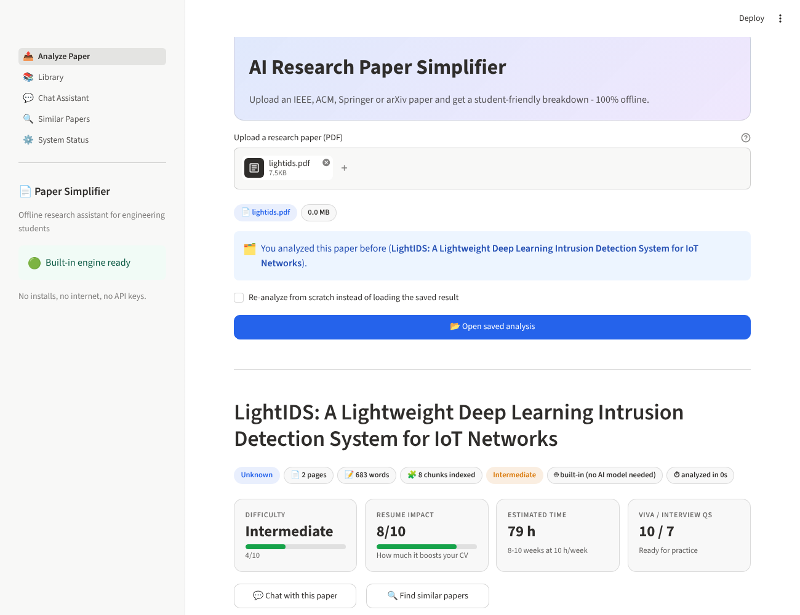

# 📄 AI Research Paper Simplifier

Upload a research paper (IEEE, ACM, Springer, arXiv, Elsevier) as a PDF and get a **student-friendly analysis** built for engineering students.

**There is nothing to set up besides Python.** You don't need Ollama, model downloads, API keys, an internet connection or a GPU. The app has a **built-in analysis engine** written in pure Python. You install the requirements and run it in VS Code.



## ✨ Features

| Core analysis | Advanced features |
|---|---|
| Simple summary + everyday analogy + key terms | 💬 **Chat assistant**: answers from the paper, with page citations |
| Problem statement | 🎓 **Viva questions** with answers |
| Key contributions + keywords | 💼 **Interview questions** with answers |
| Methodology explained step by step + "jargon decoder" | 🗺️ **Implementation roadmap** (week-by-week) |
| Implementation steps | 🔍 **Similarity search** across your papers |
| Datasets used | ⚡ **One-click "Build this Paper as a Project"**: a starter-kit .zip |
| Tools and frameworks | 📊 **Difficulty score** (Beginner / Intermediate / Advanced) |
| Limitations and future work | 🚀 **Resume impact score** (1–10) |
| Student project idea | ⏱️ **Estimated implementation time** |
| Export to **Markdown / PDF / JSON** | 📚 **History library** stored locally (SQLite) |

## 🧠 How the built-in engine works (no AI model)

1. **Reads the PDF** with PyMuPDF, handling two-column layouts and removing headers and page numbers.
2. **Splits it into sections** (Abstract, Introduction, Method, Experiments, Limitations, Conclusion…).
3. **Ranks the most important sentences** in each section. It combines similarity to the section's main topic with cue phrases such as "we propose", "however", "limitation" and "in the future".
4. **Extracts facts**: datasets, tools, metrics, keywords (including the paper's own "Index Terms") and jargon, which it explains with a built-in glossary of 60+ engineering terms.
5. **Detects the domain** (Computer Vision, NLP, Cybersecurity, Networking/IoT, Blockchain, Signal Processing, Robotics, ML) and fills project, roadmap and question templates with the paper's own details.
6. **Searches** with local hashed embeddings stored in ChromaDB, for both chat and similarity search.

Everything it says *about the paper* comes from the paper itself, with page numbers, so it can't make things up. Suggestions it generates (project ideas, implied limitations) are clearly labelled. A typical paper is analyzed in **under 5 seconds**.

> **Optional:** if you ever want rewritten, more conversational text from a local AI model, the app can also use the free Ollama app. Set `RPS_ENGINE=ollama` in `.env` (see the System Status page). This is completely optional.

## 💸 Cost: everything is free

All dependencies are free and open source: Streamlit, PyMuPDF, ChromaDB, Pydantic, fpdf2, SQLite. No accounts or subscriptions are needed.

> PyMuPDF is AGPL-3.0. That's fine for personal, academic and open-source projects.

## 🧑‍💻 Run in VS Code (step by step)

### 1. Install once
* **Python 3.10 – 3.13** from <https://www.python.org/downloads/>. On Windows, tick **"Add Python to PATH"** during installation.
* **VS Code** from <https://code.visualstudio.com/>.

### 2. Open the project
**File → Open Folder…** and select the `research-paper-simplifier` folder. When VS Code suggests the recommended **Python** extensions, click **Install**.

### 3. Set up (one time, about 3 minutes)
**Terminal → Run Task…**, then:
1. **1. Create virtual environment**
2. **2. Install requirements**

Then press `Ctrl+Shift+P` → **Python: Select Interpreter** → choose the one with **`.venv`**.

### 4. Run
Press **F5** and choose **▶ Run App (Streamlit)**. Your browser opens at **http://localhost:8501**. Upload a PDF and click **🚀 Analyze paper**.

To stop the app, press the red ■ square in the VS Code debug toolbar.

### Prefer the terminal?
On Windows (PowerShell or the VS Code terminal):

```bash
py -m venv .venv
```

```bash
.venv\Scripts\activate
```

```bash
pip install -r requirements.txt
```

```bash
streamlit run app.py
```

On macOS / Linux, use `python3 -m venv .venv` and `source .venv/bin/activate` instead of the first two commands.

### Tests
Use the **Testing** panel (flask icon) in VS Code, or run:

```bash
python -m pytest -q
```

## 📁 Folder Structure

```
research-paper-simplifier/
├── app.py                        # Streamlit entry point
├── requirements.txt
├── .vscode/                      # F5 run/debug configs, tasks, recommended extensions
├── .env.example                  # optional configuration (RPS_*)
├── .streamlit/config.toml        # upload limit, theme, telemetry off
├── frontend/                     # presentation layer (Streamlit only)
│   ├── app_shell.py, navigation.py, state.py, components.py, styles.py
│   └── views/                    # analyze, analysis_view, library, chat, similarity, system
├── backend/                      # application layer
│   ├── container.py              # wires everything together (picks the engine)
│   ├── analysis_pipeline.py      # extract → index → generate → score → save
│   ├── library_service.py        # list / load / delete papers
│   ├── models.py                 # Pydantic domain models
│   └── prompts.py                # analysis task definitions (+ prompts for the optional LLM)
├── services/
│   ├── builtin_engine.py         # ⭐ default zero-setup analysis engine
│   ├── nlp_toolkit.py            # sentence ranking, keyphrases, hashed embeddings, glossary
│   ├── domain_profiles.py        # domain detection + tailored templates
│   ├── pdf_service.py            # PyMuPDF extraction & validation
│   ├── chunking.py               # section-aware chunking
│   ├── embedding_service.py, vector_store.py, rag_service.py   # local search (ChromaDB)
│   ├── chat_service.py, similarity_service.py, scoring_service.py
│   ├── export_service.py         # Markdown + PDF export
│   ├── project_kit_service.py    # "Build this Paper" starter kit
│   └── llm_service.py            # optional Ollama client
├── database/                     # schema.sql, connection.py, repository.py
├── utils/                        # config, exceptions, logger, text, json, progress
├── tests/                        # 45 tests (pipeline, engine, PDF, chat, exports...)
└── docs/                         # ARCHITECTURE.md, SCREENSHOTS.md, screenshots/
```

## 🗄️ Database Schema

Defined in [`database/schema.sql`](database/schema.sql) and created automatically on first run (`data/history.db`):

| Table | Key columns |
|---|---|
| `papers` | `id`, `title`, `filename`, `file_hash` (UNIQUE, so the same PDF is never analyzed twice), `page_count`, `word_count`, `source`, `chunk_count`, `created_at` |
| `analyses` | `id`, `paper_id` → papers (CASCADE), `llm_model`, `embedding_model`, `analysis_json`, `difficulty_level`, `difficulty_score`, `resume_impact_score`, `estimated_hours`, `duration_seconds`, `created_at` |
| `chat_messages` | `id`, `paper_id` → papers (CASCADE), `role`, `content`, `sources_json`, `created_at` |
| `v_paper_library` (view) | each paper with its latest analysis |

ChromaDB (`data/chroma/`) stores the search vectors for chunks and paper profiles.

## ⚙️ Configuration (optional)

The app works without any configuration. To change limits, copy `.env.example` to `.env`:

| Variable | Default | Purpose |
|---|---|---|
| `RPS_ENGINE` | `builtin` | `builtin` (no setup) or `ollama` (optional local AI) |
| `RPS_MAX_PAGES` / `RPS_MAX_FILE_SIZE_MB` | `100` / `50` | upload limits |
| `RPS_CHUNK_SIZE` / `RPS_RETRIEVAL_TOP_K` | `1400` / `6` | search tuning |
| `RPS_DATA_DIR` | `./data` | where history, vectors and logs are stored |

## 🛠️ Troubleshooting

| Problem | Fix |
|---|---|
| `py` / `python` is not recognized | Reinstall Python with **"Add Python to PATH"** ticked, then restart VS Code |
| PowerShell: "running scripts is disabled" | Run `Set-ExecutionPolicy -Scope CurrentUser RemoteSigned` once |
| F5 says "No module named streamlit" | Select the `.venv` interpreter (`Ctrl+Shift+P` → Python: Select Interpreter) |
| `pip install` fails on chromadb (Windows) | Use Python 3.11–3.13 64-bit and upgrade pip: `python -m pip install --upgrade pip` |
| "PDF looks scanned" | The PDF is only images. Run OCR first (for example, the free `ocrmypdf`) |
| Port 8501 already in use | Stop the other Streamlit window, or run `streamlit run app.py --server.port 8502` |

Logs are written to `data/logs/app.log`.

## 📖 More
* [Architecture: step-by-step explanation](docs/ARCHITECTURE.md)
* [Screenshots and descriptions](docs/SCREENSHOTS.md)
