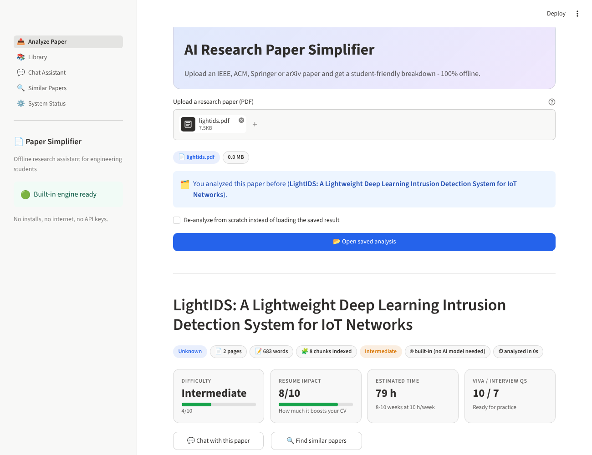
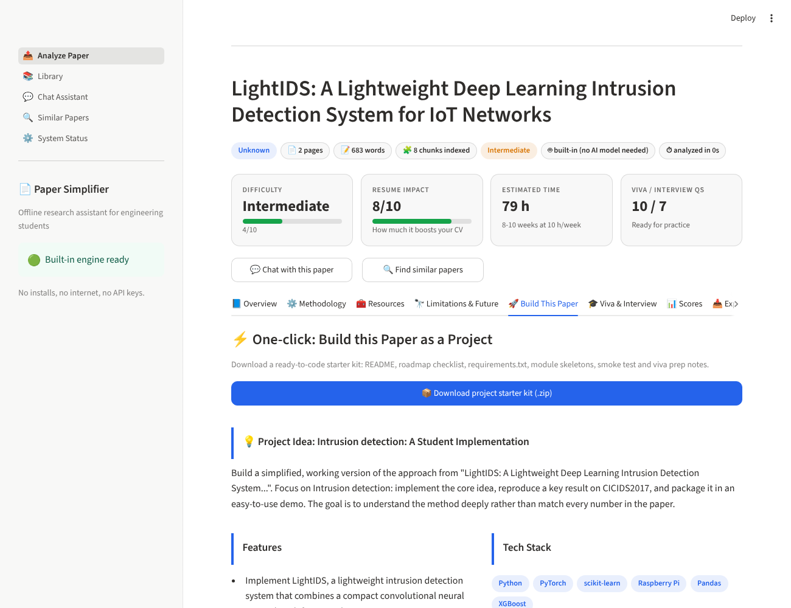
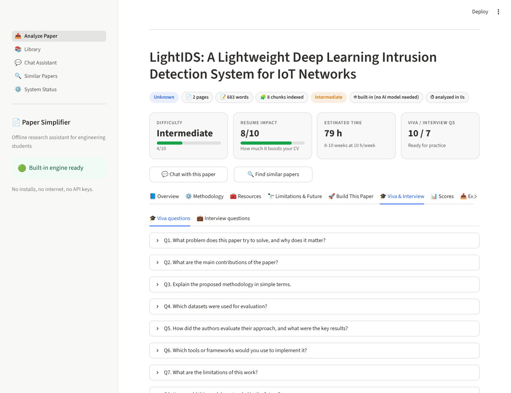
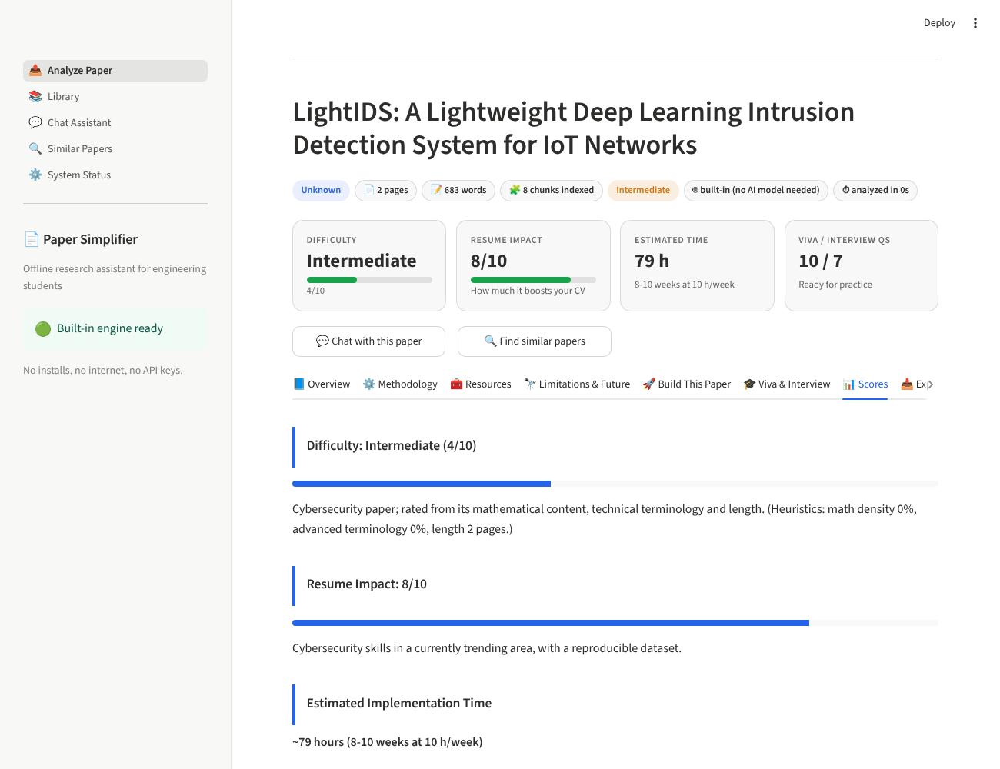
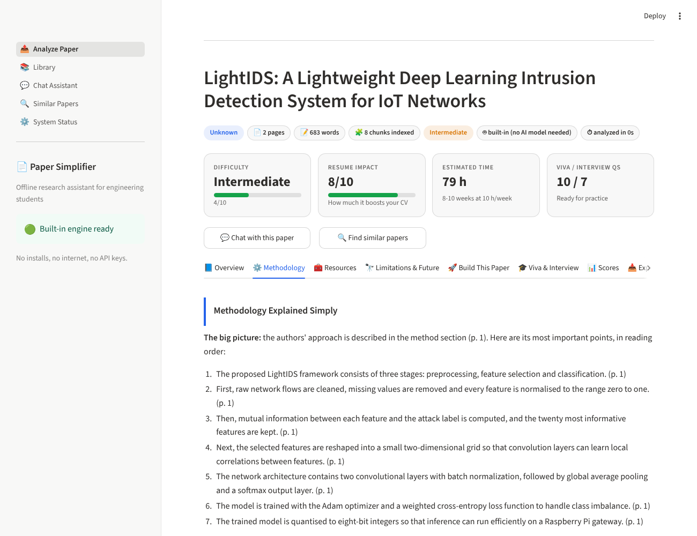
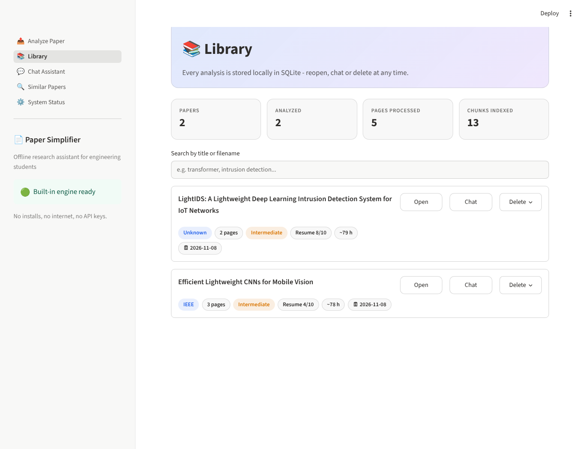
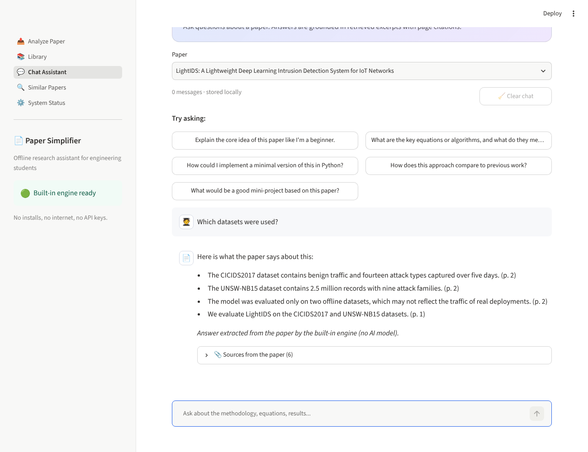
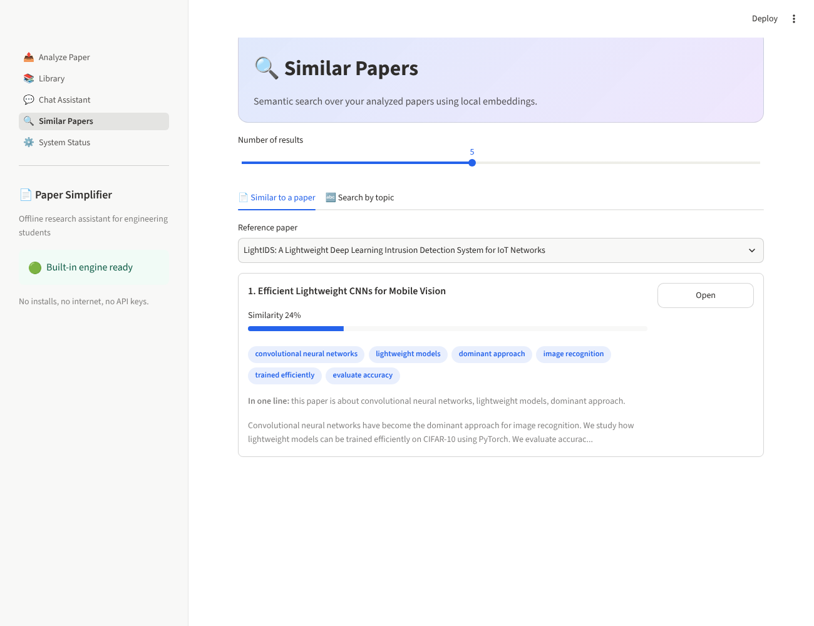
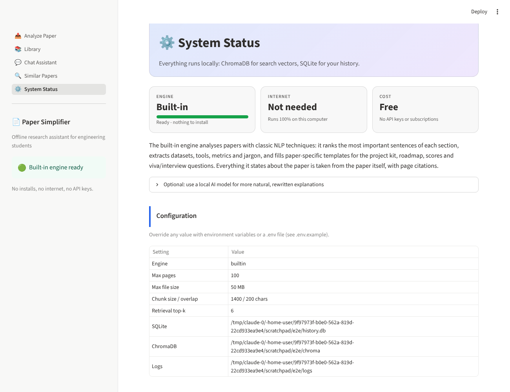

# Screenshots & Mockup Descriptions

The images in `docs/screenshots/` are **real screenshots** of the app running with its default **built-in engine**: no Ollama, no AI model and no internet. The paper shown is `tests/sample_paper.py`, a realistic IoT intrusion-detection paper written for testing.

## 1. Analyze Paper: upload and live progress

* **Hero banner** with the app name and the offline promise.
* **Sidebar status:** a green "Built-in engine ready" badge with "No installs, no internet, no API keys."
* **Drag-and-drop uploader** (PDF only, 50 MB). After upload, badges show the filename and size. If the paper was analyzed before, an info box offers *Open saved analysis* or a *Re-analyze* checkbox.
* **While analyzing** (mockup): an expanding `st.status` panel titled "Analyzing **paper.pdf**…" containing:
  * a progress bar such as `[4/8] Identifying limitations & future work… · 2s`
  * a step log:
    ```
    ✅ Reading PDF...
    ✅ Extracting text
    ✅ Splitting paper into sections and chunks...
    ✅ Embedding chunks
    ✅ [1/8] Writing the simple summary & problem statement
    ⏳ [4/8] Identifying limitations & future work
    ```
  * When finished (a few seconds with the built-in engine), the report appears below.

## 2. Analysis report: header and Overview tab
* Title, then badges: venue (IEEE), pages, words, chunks indexed, a color-coded difficulty (green/amber/red), the model, and the analysis duration.
* **Four metric cards** (two per row on phones): Difficulty with a bar, Resume impact with a bar, Estimated time (hours and weeks), and Viva/Interview question counts.
* Buttons for **💬 Chat with this paper** and **🔍 Find similar papers**.
* Tabs: Overview · Methodology · Resources · Limitations & Future · Build This Paper · Viva & Interview · Scores · Export.
* The Overview tab shows the Simple Summary, Problem Statement, Key Contributions (bullets) and Keywords (chips).

## 3. Build This Paper tab

* A full-width primary button: **📦 Download project starter kit (.zip)**, which delivers the whole project in one click.
* A Project Idea card (title, description, features, deliverables, tech-stack chips), followed by objective, architecture, modules, setup steps, evaluation metrics and stretch goals.
* A **vertical roadmap timeline**: a blue dot per phase, the duration in grey, and the tasks listed underneath.

## 4. Viva & Interview tab

Nested tabs (🎓 Viva / 💼 Interview). Each question is a collapsible expander, so students can practise answering before revealing the model answer.

## 5. Scores tab

Difficulty and resume-impact progress bars with rationales (including the heuristic factors), the time estimate, and a "Skills you will gain" list.

## 6. Methodology tab

The paper's method in numbered reading-order steps with page citations, followed by a **Jargon decoder** that explains technical terms in plain English.

## 6b. Export tab
Three buttons: **Markdown**, **PDF report** (styled A4 with a blue section rule and page numbers) and **Raw JSON**, plus a collapsible Markdown preview.

## 7. Library

Stat cards (papers, analyzed, pages, chunks), a search box, and one bordered card per paper with badges (venue, pages, difficulty, resume score, hours, date) and **Open / Chat / Delete** actions. Delete asks for confirmation in a popover.

## 8. Chat Assistant

A paper selector, a message counter, a 🧹 Clear button, and chat bubbles (🧑‍🎓 student / 📄 paper). Answers stream token by token and end with a collapsible **📎 Sources from the paper** list (page, section, excerpt). An empty chat shows five suggested-question buttons.

## 9. Similar Papers

A result-count slider and two tabs: *Similar to a paper* (selectbox) and *Search by topic* (free text). Each result card shows its rank, title, a similarity percentage bar, keyword chips, a summary snippet and an **Open** button.

## 10. System Status

Cards showing Engine: Built-in (ready), Internet: Not needed, Cost: Free; an explanation of how the engine works; an optional (collapsed) note about using a local AI model; and the configuration table.

## 11. Mobile (390 px)
The sidebar collapses into a hamburger menu, columns stack, metric cards switch to a two-column grid, tab labels shrink, and there is no horizontal scrolling.
